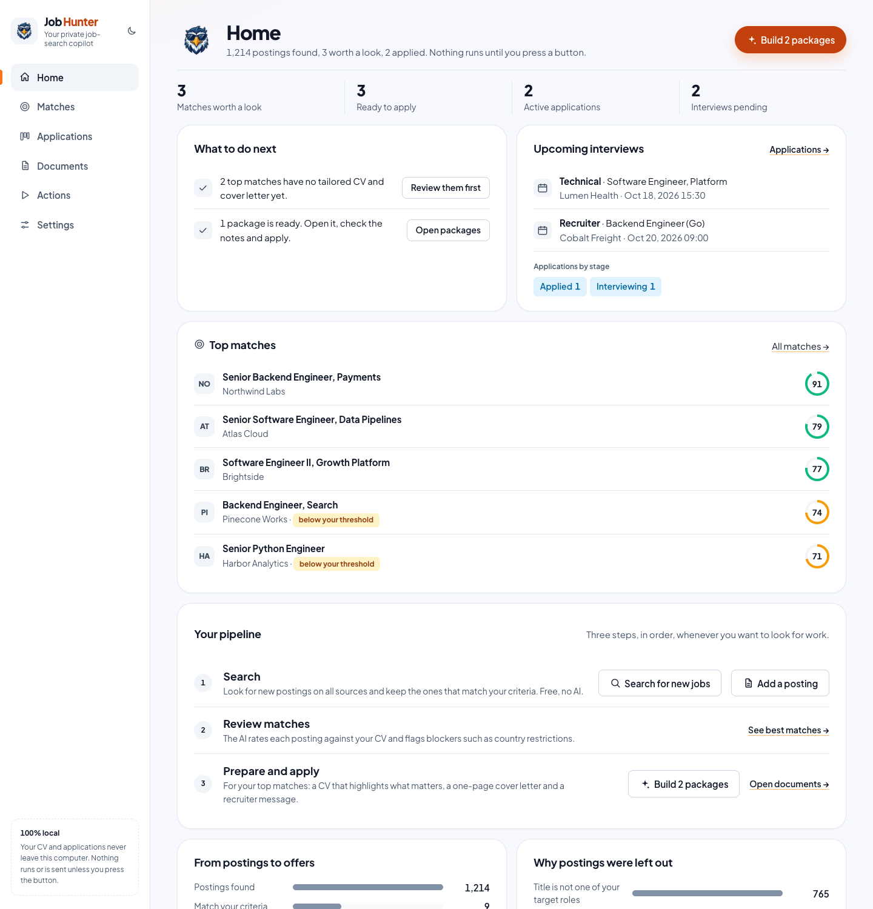
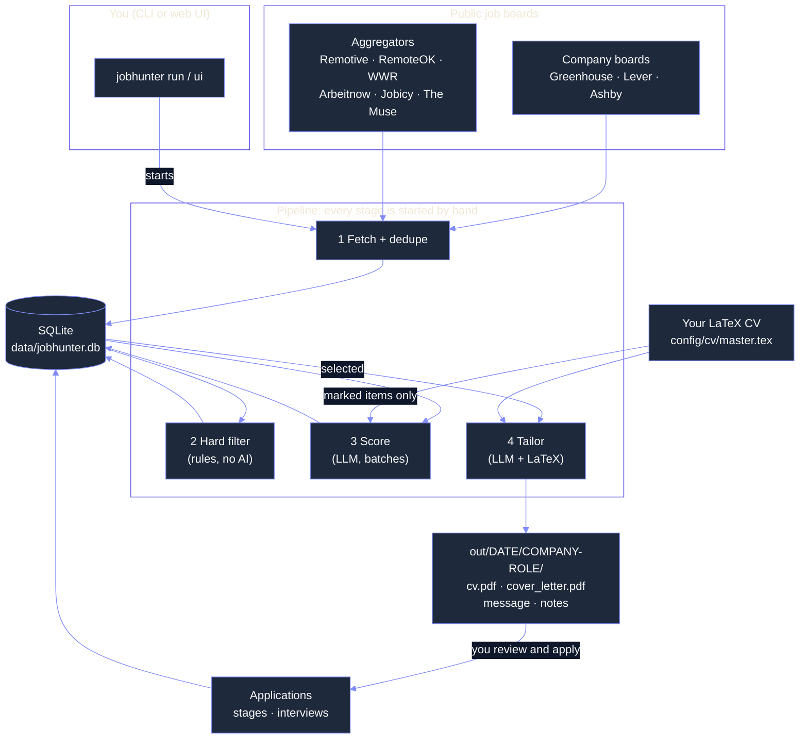
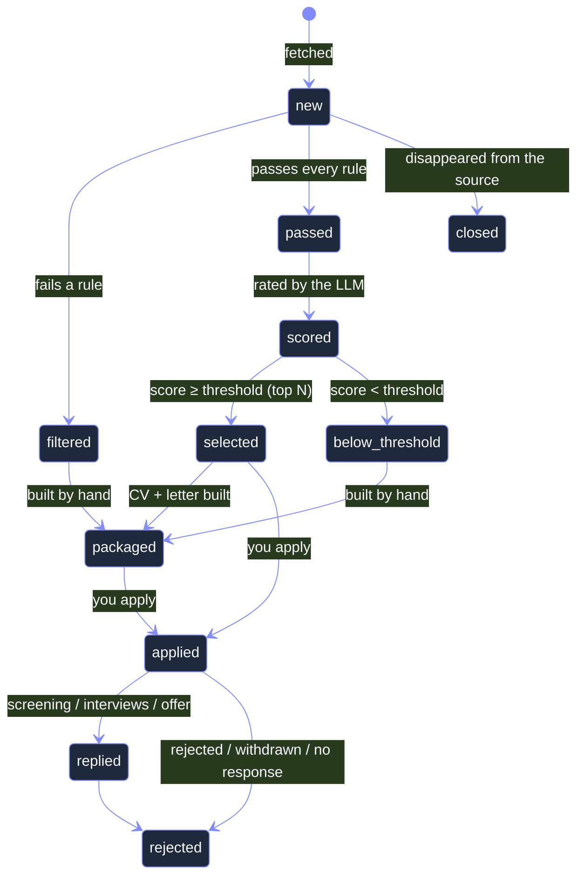
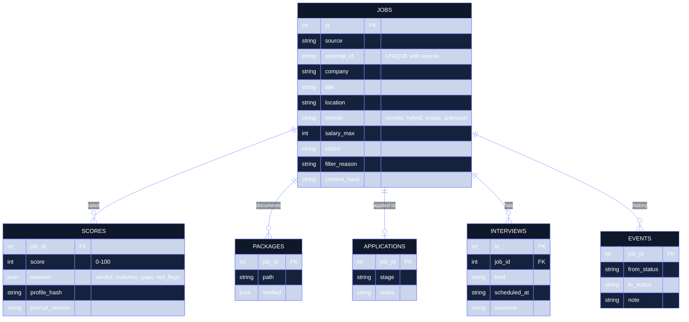
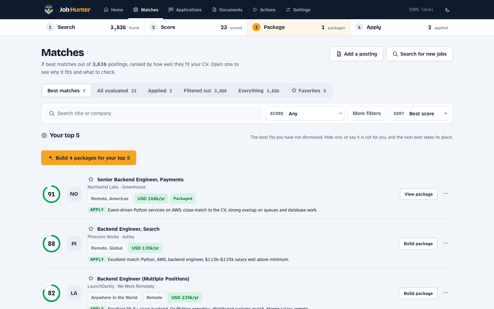
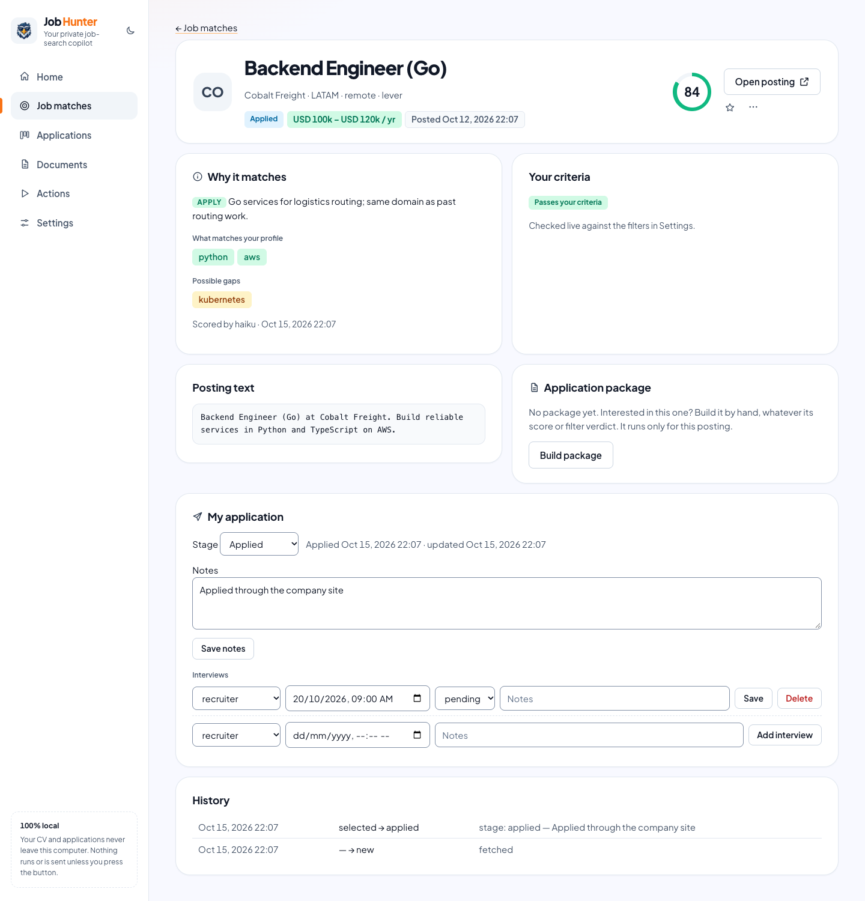
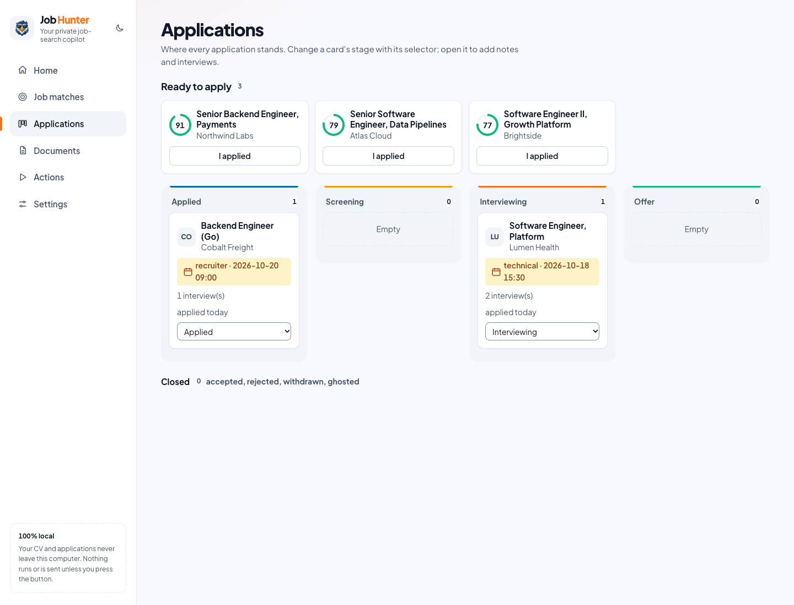
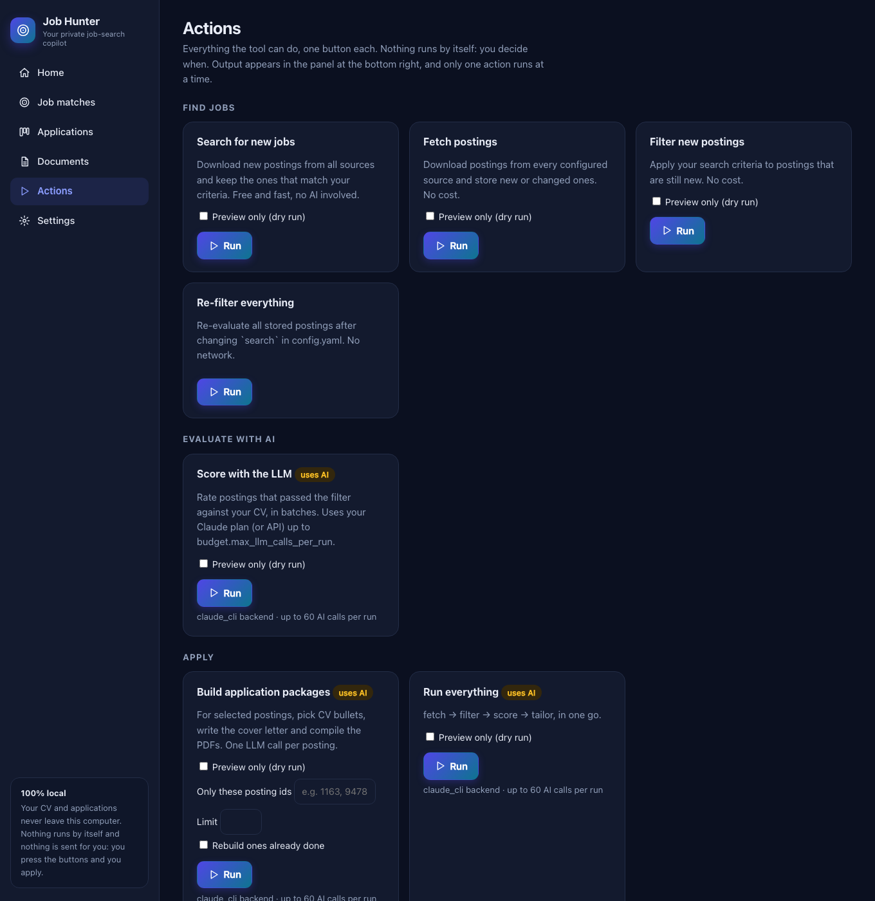
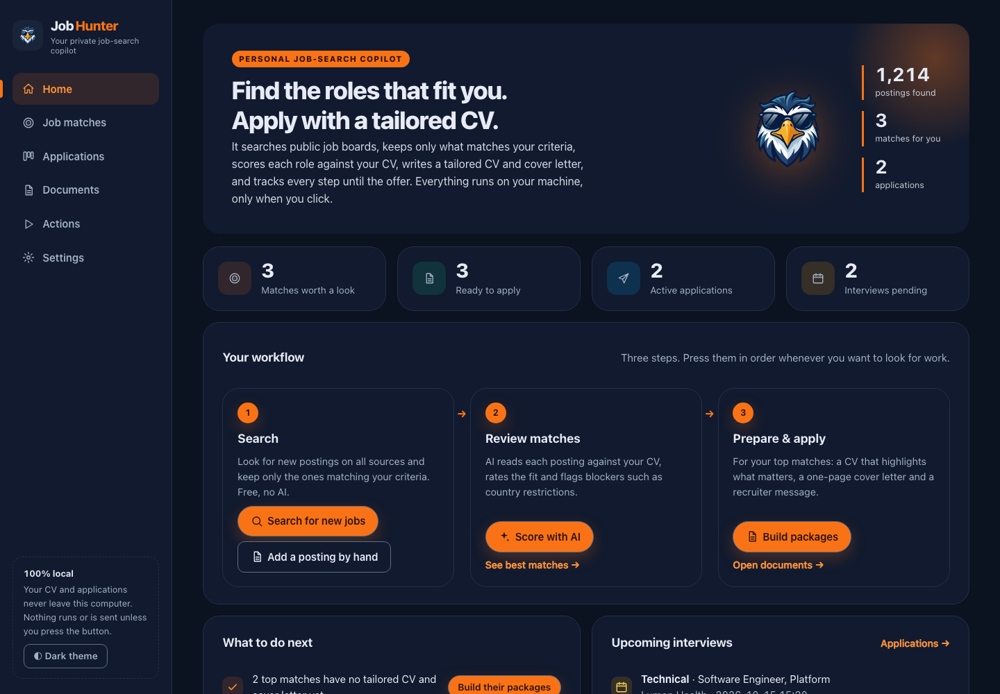
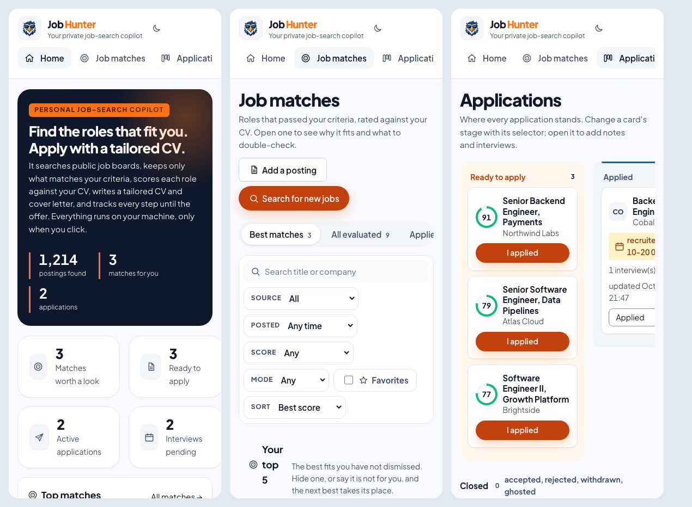

# Job Hunter


**A personal job-search copilot.** It looks for roles on public job boards, keeps only the ones that fit your criteria, rates each one against your CV with an LLM, writes a tailored **LaTeX CV and cover letter** for the best matches, and tracks every application and interview until the offer.

Everything runs on your machine and **only when you press a button**: nothing is scheduled, nothing is sent for you.

<div align="center">



</div>

> 🧪 **Try the UI in one minute with fictional data** (it never touches your real data):
> ```bash
> uv sync && uv run jobhunter demo --open
> ```

<br>

## 🎯 What it does

| Step | What happens | Uses AI? |
|---|---|---|
| **1. Search** | Downloads postings from public job boards (Greenhouse, Lever, Ashby and five remote-job aggregators) and removes everything that does not match your criteria: role, seniority, remote, location, salary, key technologies | No |
| **2. Review matches** | An LLM reads each survivor against your CV, scores it 0-100 and flags **explicit blockers** (country restrictions, work authorization, required time zone) | Yes |
| **3. Prepare** | For the best matches, picks and orders the bullets of your CV, writes a one-page cover letter and a recruiter message in the **posting's language**, compiles both PDFs and checks them for invented facts | Yes |
| **4. Apply & track** | You apply on the company site. You record it here and follow the application through screening, interviews and offer | No |

You can also build a package **by hand for any posting** you like, whatever its score.

<br>

## 🛠️ Requirements

- Find roles that match *one person's* criteria across many companies, not just a hand-picked list.
- Keep the LLM cost small and predictable: code does the discovery and filtering, the LLM only judges and writes.
- Never invent experience: the LLM chooses and orders facts from the person's own LaTeX CV and cannot add new ones.
- Keep the human in control: no automatic runs, no automatic applications, no data leaving the machine except the text sent to the LLM.
- Let anyone clone the repository and try it: the repo holds code and examples only; settings, CV, database and generated documents are gitignored.

<br>

## 👩🏻‍💻 Implementation

### Architecture

<div align="center" style="max-width: 760px; margin: 0 auto;">



</div>

1. **Fetch:** every source is a small adapter that returns normalized `Job` objects. A failing source never stops the others; a posting seen twice is stored once, changed content resets its verdict, postings that disappear for 7 days are closed, and the same job on two sources is marked duplicate (the company board wins).

2. **Filter:** deterministic rules in a fixed order (age, company block list, excluded and wanted titles, seniority, remote, location, technologies, salary). Each rejection stores a reason, so `explain` and the UI can say exactly why a posting was dropped. 25,000 postings are evaluated in under a second.

3. **Score:** postings that pass are rated in **batches** (about 8 per LLM call) against a plain-text digest of the marked parts of your CV. The prompt only allows blockers that the posting states explicitly. Scores are cached by `(posting content, CV, context, prompt version)`, so nothing is scored twice.

4. **Tailor:** one LLM call returns which bullets to keep and in what order, the cover letter and the recruiter message. Code then copies your **original LaTeX** for the chosen bullets, trims it deterministically to your page limit, fills the letter template, compiles both PDFs and runs the checks (ids, numbers, technologies, clichés, length, pages).

5. **Track:** you apply yourself and record it. Stages and interviews feed the funnel on the dashboard.

### Posting lifecycle

<div align="center" style="max-width: 760px; margin: 0 auto;">



</div>

### Data modeling

<div align="center" style="width: 80%; max-width: 560px; margin: 0 auto;">



</div>

`favorites` (bookmarks, kept apart from the posting status), plus two more tables, `fetch_log` (what each source returned, or why it failed) and `llm_calls` (tokens and cost of every call), explain what the tool did and what it cost. Migrations are versioned in `db.py`.

### Web UI

The interface uses the Kinetic Horizon look (orange brand, mascot, self-hosted Plus Jakarta Sans; no external requests). It is light by default; the sidebar has a toggle for an optional dark theme that your browser remembers.

`uv run jobhunter ui --open` serves a local dashboard on `127.0.0.1`. Every button runs the same command as the CLI and streams its log into a panel on the page.

What you can do there:

- **Home:** a guided 3-step workflow (Search → Score with AI → Build packages), KPIs, a plain-language "what to do next" list, upcoming interviews and the funnel.
- **Job matches:** tabs (best matches, all evaluated, applied, filtered out, **★ Favorites**), search and filters (including a *Favorites only* toggle and *Favorites first* sort), one-click *Build package* / *I applied* / *Hide*. **Any posting** can get a package by hand, whatever its score.
- **Add a posting by hand:** *Add a posting* on Home and Job matches. Paste a link (one request to that page pre-fills the form; sites that need a login do not work) or just the text, review the fields and save. It skips your filters (you chose it), shows a *Manual* badge and has its own *Score this posting with AI* and *Build package* buttons. Adding the same link twice updates the same posting.
- **Favorites:** a ★ on every card and posting page, for any status (filtered-out or closed ones too). It is only a bookmark: it never changes the posting's status, and a re-filter, dedupe or closing never removes it. Add a short note ("ask about the visa") on the posting page; closed favorites show a *Closed* badge. Home links to the favorites you have not applied to.
- **Block list:** *Block this company* on a posting page (asks first, then offers *Re-filter now*), or edit the list in Settings (× to remove). Postings of a blocked company are filtered out, now and in future searches; applied, in-process, rejected, hidden and packaged postings are left alone. A favorite from a blocked company keeps its star and shows a *Blocked company* badge.
- **Applications:** kanban from *Ready to apply* to *Offer*, notes and interviews (type, date, outcome) per application.
- **Documents:** every generated CV and cover letter with its checks, the recruiter message, and a **Delete** button per package.
- **Actions:** every stage and maintenance command with its options (dry run, only these ids, limit, rebuild).
- **Settings:** edit everything: search criteria, AI engine and limits, sources and company list, your LaTeX CV and your cover-letter template.

| | |
|---|---|
|  **Job matches:** AI score, why it fits, what to verify, one-click build/apply |  **Posting detail:** score, live filter verdict, package, notes and interviews |
|  **Applications:** kanban from *Ready to apply* to *Offer*, with a collapsible *Closed* group |  **Actions:** every stage with its options, dry-run included |
|  **Dark theme:** optional, one click in the sidebar (light is the default) |  **Small screens:** usable down to about 390 px |

### Observations

- **Filtering before the LLM.** 99% of postings are discarded by free, explainable rules. The LLM only sees what is worth reading, which is why a full run costs a few calls instead of thousands.
- **The LLM never writes your CV.** In `select` mode it returns bullet ids; code copies your original LaTeX. Contact details live in the preamble, which is never sent to the LLM.
- **No API key required.** The default backend runs `claude -p` with your own Claude subscription login; `anthropic_api` is available if you prefer a key. Extended thinking is disabled for scoring: a batch went from about 2 minutes to about 11 seconds with the same verdicts.
- **Only explicit blockers count.** The first scoring trial marked every "USA" posting as a blocker; the prompt now requires the posting to state a restriction (residency, work authorization, time zone, excluded country).
- **Everything is manual.** There is no scheduler. The UI only listens while `jobhunter ui` is running, and it rejects requests from other hosts, other origins and non-JSON writes.
- **Packages are replaced atomically.** A rebuild is written in a temporary folder and swapped in, so a failed run never leaves half old, half new files.
- **Tests never touch your data.** Each test runs in an empty temporary directory.

<br>

## ⚙️ How To Run

Requirements: macOS or Linux (Windows through WSL), [`uv`](https://docs.astral.sh/uv/) (it installs Python 3.12 for you) and [tectonic](https://tectonic-typesetting.github.io) or a TeX Live with `latexmk` (the LaTeX engine; `brew install uv tectonic` on macOS; `latex.engine: auto` uses whichever is installed). Details per system in [`docs/SETUP.md`](docs/SETUP.md).

### Setup (once)

**Install it as a tool and create a workspace** (no clone needed):

```bash
uv tool install git+https://github.com/Valentina17varela/job-hunter
mkdir my-job-search && cd my-job-search
jobhunter init --sample-cv     # config/, a letter template and (optional) a fictional sample CV
jobhunter doctor               # checks Python, config, LaTeX and the LLM login
jobhunter companies discover   # builds your company list (optional, recommended)
```

`jobhunter init` never overwrites a file and adds your personal files to `.gitignore`. Without `--sample-cv` you bring your own CV (step 3 below). Everything you create lives in that folder (`config/`, `data/`, `out/`), so commands are run from it.

**Or work from a clone** (to change the code): `git clone https://github.com/Valentina17varela/job-hunter && cd job-hunter && uv sync`, then use `uv run jobhunter …` in the examples. The repository's `config/config.example.yaml` is copied by `jobhunter init`, or by hand to `config/config.yaml`.

**With Docker** (no local Python or LaTeX; use the API or an OpenAI-style backend, the `claude` CLI is not inside the image): see [`docs/SETUP.md`](docs/SETUP.md#docker).

Then:

1. **Say what you want.** Edit the `search:` block of `config/config.yaml` ([example below](#-configuration)).
2. **Log in to Claude** (default AI backend, uses your subscription, no API key): run `claude auth login` in your own terminal. Prefer a key? Set `llm.backend: anthropic_api` and export `ANTHROPIC_API_KEY`.
3. **Add your LaTeX CV** at `config/cv/master.tex` and mark it ([how](#your-latex-cv)); copy the letter template with `uv run jobhunter letter init` and edit its three header lines.
4. **Tell the AI how you can work** in `scoring.candidate_context` (where you live, what is a deal-breaker).

### Everyday use (all by hand)

**In the UI:** `uv run jobhunter ui --open`, then press **Search for new jobs → Score with AI → Build packages** on the Home page, open the documents, apply on the company site, and mark it in **Applications**.

**Or from the terminal:**

```bash
uv run jobhunter run --stage search      # 1. fetch + filter (free)
uv run jobhunter run --stage score       # 2. rate the survivors with the LLM
uv run jobhunter run --stage tailor      # 3. build CV + cover letter for the best matches
uv run jobhunter run --stage tailor --job 1163   # …or for any posting you pick, by id
uv run jobhunter add --title "Backend Engineer" --company Acme --url https://acme.com/jobs/1 --text-file job.txt --score --package   # a posting found elsewhere
uv run jobhunter run --stage score --job 1163    # score only these ids
uv run jobhunter review                  # packages waiting for you
uv run jobhunter mark 1163 applied       # keep track (screening, interviewing, offer, rejected…)
```

`uv run jobhunter run` does steps 1-3 in one go. `--dry-run` shows what would happen without doing it.

### Your LaTeX CV

`config/cv/master.tex` is your own LaTeX CV plus `% jh:` comments that say which parts the tool may select. Compiling it still gives your original CV. Everything outside the markers, including your header with name and contact details, is copied untouched and **never sent to the LLM**.

```latex
% jh:section experience
\section*{WORK EXPERIENCE}
% jh:entry exp-acme required          % a job or project; "required" = never dropped
\noindent \textbf{Software Engineer, Acme} \\
% jh:item exp-acme-1 tags=python,aws  % one bullet (ends at the next marker or a blank line)
• Cut latency by 40\% \\
% jh:item exp-acme-2
• Built an API \\
% jh:endentry
% jh:endsection
```

`uv run jobhunter cv check` validates the markers and compiles the file; `uv run jobhunter cv init plain.tex` proposes markers for a CV that uses `\item`. For postings in another language, `uv run jobhunter cv translate --lang es` translates your CV once into a file you review.

### 🔧 Configuration

Everything lives in `config/config.yaml` (copy of [`config.example.yaml`](config/config.example.yaml), validated on load with errors that name the field). The part you will edit most:

```yaml
search:
  titles_include: ["software engineer", "backend", "python"]  # at least one in the title
  titles_exclude: ["intern", "junior", "frontend", "mobile"]  # any match rejects (whole words)
  keywords_include: ["python", "typescript", "golang"]        # at least one in the posting
  companies_exclude: ["Acme"]                                 # block list: whole company names
  seniority: ["mid", "senior"]                                # junior | mid | senior | lead
  work_mode: ["remote"]                                       # remote | hybrid | onsite
  locations_allowed: ["Colombia", "LATAM", "Worldwide", "Anywhere", "Global"]
  salary:
    min_usd: 80000       # ANNUAL USD (monthly × 12); hourly/monthly pay is annualized, other currencies converted
    on_missing: pass     # keep postings that do not publish a salary
  max_age_days: 30       # aggregator postings only
```

You can edit all of this **in the UI** (Settings): tag inputs, checkboxes and plain-language hints, **Save & re-filter** in one click. Saving writes `config/config.yaml` keeping your comments (except inside a list you edit), validates every value first, and keeps a `.bak` of the previous version plus a one-time `.orig`. The same page edits your **LaTeX CV**, **cover-letter template** and **company list**. Prefer files? Edit `config.yaml` by hand and press **Re-filter everything** in Actions (or `uv run jobhunter refilter`). The dashboard shows which rule discards the most postings so you know what to loosen.

<details>
<summary><b>CLI reference</b></summary>

Every command that reads settings accepts `--config FILE` (default `config/config.yaml`).

| Command | What it does |
|---|---|
| `jobhunter init [FOLDER] [--sample-cv]` | Create `config/` (config, letter template, optional sample CV) from the bundled examples; never overwrites, updates `.gitignore` |
| `jobhunter demo [FOLDER] [--port N] [--open] [--no-serve]` | Create a workspace with fictional data and start the UI on it |
| `jobhunter ui [--port N] [--open] [--bind ADDRESS] [--allow-host HOST]` | Local web UI on `127.0.0.1`. `--bind` and `--allow-host` exist for containers only (a warning is printed); the UI still refuses any other Host |
| `jobhunter add --title T --company C [--url U] [--location L] [--remote MODE] [--salary-min N] [--salary-max N] [--currency CUR] [--text-file F] [--score] [--package]` | Add a posting you found elsewhere |
| `jobhunter run [--stage search\|fetch\|filter\|score\|tailor] [--dry-run]` | Run the pipeline or one stage. `search` = fetch + filter |
| `jobhunter run --stage tailor --job ID [--limit N] [--force]` | Build packages for exactly these postings, whatever their status |
| `jobhunter refilter` | Re-evaluate every stored posting after changing `search` |
| `jobhunter explain ID` | Why a posting passed or was rejected, with the matching text |
| `jobhunter review` | Packages waiting for you |
| `jobhunter mark ID STAGE [--note]` | `applied`, `screening`, `interviewing`, `offer`, `accepted`, `rejected`, `withdrawn`, `ghosted` |
| `jobhunter favorite ID [--note TEXT] [--remove]` | Star a posting (any status), optionally with a note, or remove its star |
| `jobhunter favorites` | List starred postings, newest first |
| `jobhunter stats` | Funnel, rejections by rule, applications by stage, LLM usage |
| `jobhunter calibrate [--count N]` | Say y/n to the AI's verdicts to measure how well it matches your judgement |
| `jobhunter cv check \| init [--output FILE] \| translate` | Validate/compile your CV, propose markers, translate once |
| `jobhunter letter init` | Create your cover-letter template from the example |
| `jobhunter companies discover \| check` | Grow / validate the list of company boards |
| `jobhunter doctor` | Check Python, config, LLM login and LaTeX; under each problem it prints a `fix:` line for your system (macOS, Linux, WSL, Windows, Docker) |

</details>

<details>
<summary><b>Sources</b></summary>

Only public APIs and feeds (the full table with terms links is [`docs/SUPPORTED_SOURCES.md`](docs/SUPPORTED_SOURCES.md)).

| Source | Notes |
|---|---|
| Greenhouse, Lever, Ashby | Company boards from your company list (`companies discover`) |
| Remotive, RemoteOK, We Work Remotely, Arbeitnow, Jobicy | Remote and EU aggregators; no keys |
| **The Muse** | Works without a key (500 requests/hour). Configure `sources.themuse` (`categories`, `levels`, `locations`, `max_pages`); a full remote Software Engineering fetch is about 43 requests. An optional free key in the environment variable `THEMUSE_API_KEY` raises the limit. The fetch stops cleanly when few requests are left and says so in the run log; the next run continues |

**Keys** are read only from environment variables, never from `config.yaml`, the database or the UI. `jobhunter doctor` and Settings → Sources show only whether each key is *set* or *not set*, and credentials are removed from error messages and logs. A source that requires a key is skipped with a warning when it is missing.

</details>

<details>
<summary><b>Project layout</b></summary>

```
config/            config.example.yaml, company_candidates.txt, letter_template.example.tex (committed)
                   config.yaml, companies.yaml, cv/ (yours, gitignored)
specs/             design specs (source of truth) and the roadmap
design/            inputs of the visual identity: palette, logo, project brief
scripts/           seed_demo.py (same as `jobhunter demo`), check_docs.py (CI: docs, specs, config in sync)
docs/               SETUP, FAQ, ADDING_A_SOURCE, SUPPORTED_SOURCES (generated), images/ (README screenshots)
.github/           CI workflow, issue and PR templates
Dockerfile, compose.yaml   container option (see docs/SETUP.md)
src/jobhunter/
  cli.py           typer commands
  pipeline.py      fetch and filter stages          filters.py   hard filter rules
  sources/         one module per source, each registers itself (registry.py)
  scoring.py       batch scoring and selection      tailoring.py CV selection, letter, verification, packages
  llm.py           claude -p / Anthropic API, budget, retries, call log
  latex.py         CV parser/assembler, escape, compile    translate.py, language.py
  applications.py  stages, interviews, stats        store.py     upsert, dedupe, close stale
  favorites.py     stars and notes on postings
  resources.py     bundled examples (config, letter template, sample CV) for `init`
  demo.py          the fictional demo workspace
  web/             FastAPI app, run manager, templates, static (tokens.css, style.css, fonts, logo)
tests/             pytest suite (no network, no LLM)
```

</details>

<br>

## 🔒 Privacy and safety

- **What reaches the LLM:** the plain text of the CV items you marked, your `candidate_context`, and the posting text. Never your name, email, phone or links (they live in the LaTeX header).
- **What stays local:** the database, your CV, the generated documents and the web UI (`127.0.0.1` only; do not put it behind a tunnel, it shows your applications).
- **Settings are safe to edit from the UI:** fields that choose a file or a program to run (`llm.claude_path`, the company files) can only be changed by hand in `config.yaml`, so a settings save can never become an arbitrary file write or code execution.
- **Delete what you do not need:** each generated package (CV, letter, notes) has a Delete button in Documents and on the posting; only folders inside `out/` are ever removed and your application record is kept.
- **Not committed:** `config/config.yaml`, `config/companies.yaml`, `config/cv/`, `data/`, `out/` and any API key.
- **One optional page fetch:** only when you press *Fetch details* in *Add a posting*, the tool requests that single link (public hosts only: private, loopback and link-local addresses are refused; 2 MB and 10 s limits). Nothing else is fetched outside the job sources.
- **No automation:** the tool never applies, messages recruiters or runs in the background.
- **Source terms:** aggregators ask for a link back to the original posting; every posting keeps its original URL and the tool is for personal use.

<br>

## 🧪 Development

```bash
uv run pytest             # no network, no LLM; each test runs in an empty temp dir
uv run ruff check . && uv run ruff format --check .
uv run python scripts/check_docs.py   # docs, specs, example config and personal files in sync
```

The project is built spec-first: [`specs/`](specs/) holds the design (index, status of each spec and a template in [`specs/README.md`](specs/README.md); overview in [`00-overview.md`](specs/00-overview.md)). [`CLAUDE.md`](CLAUDE.md) has the working conventions, the commands and the definition of done; [`AGENTS.md`](AGENTS.md) is the short version for other coding agents.

## ❓ Troubleshooting

| Symptom | Fix |
|---|---|
| `Config file not found: config/config.yaml` | `cp config/config.example.yaml config/config.yaml` |
| `doctor` says the LLM is not logged in | Run `claude auth login` in your own terminal |
| `uv` or `tectonic` not found | `brew install uv tectonic` and make sure `/opt/homebrew/bin` is in your `PATH` |
| First LaTeX compile takes about a minute | Normal: `tectonic` downloads packages once |
| Too few postings pass | Open the dashboard: the biggest bar in *Why postings were left out* is the rule to loosen |
| A package says **REVIEW** | Open its `notes.md`: it lists the failed checks; the files are still there to edit by hand |
| Want to start over | Delete `data/jobhunter.db`; it is recreated on the next run |

## 🤝 Contributing

Contributions are welcome: start with [`CONTRIBUTING.md`](CONTRIBUTING.md) (set-up in three commands, the spec-first flow and what the project does not accept). Adding a job board is one module, one fixture and one test: [`docs/ADDING_A_SOURCE.md`](docs/ADDING_A_SOURCE.md). Questions and the sources that exist: [`docs/FAQ.md`](docs/FAQ.md), [`docs/SUPPORTED_SOURCES.md`](docs/SUPPORTED_SOURCES.md). Security reports: [`SECURITY.md`](SECURITY.md). CI runs lint, tests and `scripts/check_docs.py` (keeps the README, the specs and the example config in sync with the code).

## 📄 License

[MIT](LICENSE) © 2026 Valentina Varela Alzate. The font (Plus Jakarta Sans) keeps its own SIL Open Font License next to the file in `static/fonts/`.
